  

# 🛡️ Awesome Vendor Risk Management (VRM) & TPRM

  
  
  
  
  
  
  

---

## 📖 Overview & SEO Summary

A curated directory and taxonomy of top **Vendor Risk Management (VRM)** and **Third-Party Risk Management (TPRM)** solutions. This guide tracks enterprise **SaaS platforms**, **open-source tooling**, **questionnaire scoring engines**, **SBOM cross-referencing frameworks**, and **cyber supply chain risk management (C-SCRM)** utilities.

Organizations utilize these solutions across the complete vendor lifecycle:
- 🔍 **Due Diligence & Intake**: Automated security questionnaires (SIG, CAIQ, VSA, custom) and security ratings.
- 📊 **Continuous Cyber Monitoring**: Real-time vulnerability, threat intelligence, and attack surface tracking.
- 📑 **Contract & Compliance Review**: SOC 2, ISO 27001, GDPR, HIPAA, DORA, and NIS2 verification.
- ⚠️ **Incident & Fourth-Party Risk**: Nth-party concentration risk mapping, breach notifications, and collaborative remediation.
- 🚪 **Offboarding & Archival**: Data retention validation, access revocation, and contract termination audits.

---

## 📑 Table of Contents

- [🌐 Sector Overview & Market Dynamics](#-sector-overview--market-dynamics)
- [🏢 SaaS & Hosted Enterprise Platforms](#-saas--hosted-enterprise-platforms)
- [💻 Open-Source GitHub Projects](#-open-source-github-projects)
- [📚 Regulatory & Industry Frameworks](#-regulatory--industry-frameworks)
- [🤝 How to Contribute](#-how-to-contribute)
- [💖 Support & Community](#-support--community)
- [⭐ Star History](#-star-history)
- [⚖️ Disclaimer](#️-disclaimer)

---

## 🌐 Sector Overview & Market Dynamics

- **Market Size & Growth**: The global Vendor Risk Management (VRM) and Third-Party Risk Management (TPRM) market is valued at approximately **$7.4 billion to $9.2 billion (2024–2026)** and is projected to expand to **$18.5 billion to $22.4 billion by 2032**, demonstrating a Compound Annual Growth Rate (**CAGR of ~13.5% – 15.2%**). Growth is propelled by escalating software supply chain breaches, mandatory compliance mandates (e.g., EU DORA, NIS2, SEC Cybersecurity Disclosures), and widespread enterprise reliance on interconnected SaaS ecosystems.
- **Market Structure & Fragmentation**: The VRM/TPRM sector is **moderately fragmented** rather than a winner-take-all ecosystem. Comprehensive IT Service Management and enterprise GRC giants (e.g., ServiceNow, OneTrust, ProcessUnity) hold deep penetration within large global enterprises, while specialized outside-in cyber rating providers (e.g., BitSight, SecurityScorecard) and agile vendor assessment platforms (e.g., UpGuard, Panorays, Venminder) command significant domain authority. High organizational switching costs, proprietary threat scoring methodologies, and disparate regulatory environments prevent monopolistic consolidation.

---

## 🏢 SaaS & Hosted Enterprise Platforms

The table below catalogs leading commercial VRM/TPRM platforms, sorted in **descending order by company size** (market capitalization / valuation / reported revenue).

| 🏢 Platform & Link | 📈 Company Size (Valuation / Revenue) | 💰 Starting Tier Pricing | 🎁 Free Tier & Trial Limits | 🎯 Core Capabilities & Focus |
| :--- | :--- | :--- | :--- | :--- |
| **[ServiceNow Vendor Risk Management](https://www.servicenow.com/)** | **~$185 Billion** Market Cap (Public: NYSE: `NOW`, ~$10B+ Annual Revenue) | **$3,600 / user / year** (~$300/user/mo base fulfiller license; minimum annual enterprise contracts start at **$30,000 – $50,000 / year**) | **No free-forever plan**; evaluations are conducted via a **custom 30-day guided proof-of-concept (POC)** sandbox configured through enterprise sales | Enterprise VRM natively embedded into the Now Platform; automated assessment workflows, tiering engines, vendor self-service portals, and executive GRC roll-up dashboards. |
| **[OneTrust Third-Party Risk](https://www.onetrust.com/)** | **~$5.3 Billion** Valuation (Private, $400M+ ARR, backed by Insight Partners & SoftBank) | **$10,000 – $15,000 / year** (minimum annual base contract for standalone TPRM module) | **No free tier for TPRM**; offers a **guided 14-day evaluation POC** with pre-configured assessment templates upon discovery consultation | Automated vendor onboarding, inherent risk scoring, 70+ pre-built questionnaire libraries, continuous dark web monitoring, and deep privacy/security workflows. |
| **[BitSight](https://www.bitsight.com/)** | **~$2.4 Billion** Valuation (Private, $150M+ ARR, Moody's $250M strategic investment) | **$15,000 – $20,000 / year** (baseline annual contract for mid-market continuous third-party vendor monitoring) | **No permanent free tier**; provides **1 free domain benchmark snapshot report** and an analyst-guided trial sandbox upon request | Outside-in cybersecurity ratings (250–900 scale) generated from 120+ external data feeds, tracking botnet infections, compromised credentials, and patch cadence across vendor supply chains. |
| **[Prevalent (Mitratech)](https://www.prevalent.net/)** | **~$1.5 Billion+** Valuation (Parent Mitratech, ~$300M+ Annual Revenue, backed by Ontario Teachers' & TA Associates) | **£3,625 / unit / year** (~$4,600/yr on UK G-Cloud) or **~$15,000 / year** baseline platform subscription | **Free for vendors** to join the Prevalent Vendor Evidence Sharing Network and submit profiles; **no free tier for risk teams** (guided demo available on request) | 200+ standardized assessment templates, automated tiering, continuous cyber/threat monitoring, and a Virtual Third-Party Risk Advisor trained on NIST, ISO, and SOC 2 frameworks. |
| **[ProcessUnity](https://www.processunity.com/)** | **~$1.2B – $1.5 Billion** Valuation (PE-backed by Marlin Equity Partners; acquired CyberGRX; ~$100M+ Revenue) | **$25,000 / year** (transparent entry-level starting tier for Emerging Enterprise / SMB packages) | **Free indefinitely for evaluated vendors** through the ProcessUnity Global Risk Exchange / Risk Index; **no free tier for buyers** (guided demo sandbox on request) | Universal Data Core for TPRM data, Global Risk Exchange with 16,000+ completed vendor risk assessments, and AI-powered teams for automated policy review and inherent risk scoring. |
| **[SecurityScorecard](https://securityscorecard.com/)** | **~$1.0 Billion** Valuation (Unicorn, Series E, $100M+ ARR, backed by GV & Evolution Equity) | **$20,000 / year** (starting annual contract for enterprise multi-vendor continuous monitoring) | **Free Forever plan** for 1 company domain (self-monitoring & basic scorecard); **14-day free trial** of Business tier includes visibility into **up to 5 third-party vendor scorecards** and 20 internet-exposure searches | Dynamic security letter grades (A–F), automated questionnaire exchange, CVE-level remediation requests, and fourth-party concentration risk mapping. |
| **[Venminder (Ncontracts)](https://www.venminder.com/)** | **~$400 Million** Valuation (Acquired by Ncontracts in 2024; combined parent valuation ~$1.0B; ~$50M+ ARR) | **$15,000 – $25,000 / year** for base Professional tier; **$125,000 / year** Enterprise Platform listing on AWS Marketplace | **No free-forever tier**; provides a **tailored guided trial walkthrough** with sample SOC/financial reviews upon sales consultation | Blends cloud TPRM software with expert managed services (in-house CPAs, CISSPs, and paralegals evaluating vendor SOC 2 reports, financials, and contracts). |
| **[UpGuard](https://www.upguard.com/)** | **~$450 Million** Valuation (Private, Series B, ~$45M+ ARR) | **$1,599 / month** ($19,188/year billed annually) for Starter tier (up to 50 monitored vendors, 6 user seats) | **Free Forever plan** for **up to 5 vendors** and 3 users (includes basic security ratings and Trust Exchange); **14-day free trial** for paid tiers | Security ratings, custom questionnaire builder, collaborative remediation workflows, fourth-party visibility, and automated data leak detection. |
| **[Panorays](https://panorays.com/)** | **~$180 Million** Valuation (Private, Series B, $42M total funding raised) | **$15,000 – $21,700 / year** (or £800/vendor annual monitoring + £500/vendor assessment packages) | **Free Starter Plan forever** for **up to 5 third-party suppliers** (external security ratings + automated questionnaires) and company self-assessment profile | Automated vendor risk evaluations combining internal questionnaires with external attack surface checks, verified certification discovery, and supplier profiles. |
| **[Whistic](https://www.whistic.com/)** | **~$150 Million** Valuation (Private, Series B, $50M+ total funding raised) | **$12,700 – $15,500 / year** (Whistic Core baseline tier, includes up to 25 vendor assessments) | **Free Basic Profile / Trust Center** allowing up to **3 outbound security profile shares / month**; **30-day trial** for compliance add-ons (capped at 10 automated tests) | Dual-sided vendor risk network, CrowdConfidence scoring, AI Smart Responses for vendor security inquiries, and proactive vendor Trust Centers. |

---

## 💻 Open-Source GitHub Projects

Explore sovereign, self-hostable, and code-level tools for vendor security assessment, SBOM component analysis, vulnerability alerting, and GRC automation. 

Repos are listed in **descending order by GitHub Stars_Count** ⭐.

1. **[OSV-Scanner](https://github.com/google/osv-scanner)**   
   *Vulnerability scanner for dependencies and software supply chain risk, powered by the Open Source Vulnerabilities (OSV.dev) database.*  
   Essential for validating vendor Software Bills of Materials (SBOMs) in CycloneDX and SPDX formats against known CVEs and GHSAs directly in procurement and CI/CD gates.

2. **[DefectDojo](https://github.com/DefectDojo/django-DefectDojo)**   
   *Comprehensive application vulnerability and risk management orchestration platform by OWASP.*  
   Supports tracking vendor technologies, managing security findings, conducting periodic risk reviews, and aggregating metrics across multi-party software systems.

3. **[Dependency-Track](https://github.com/DependencyTrack/dependency-track)**   
   *Intelligent Component Analysis platform for identifying and reducing software supply chain risk by OWASP.*  
   Enables organizations to consume vendor SBOMs, continuously monitor for third-party component vulnerabilities, track license compliance, and assess supplier pedigree.

4. **[OpenCVE](https://github.com/opencve/opencve)**   
   *Self-hosted platform for tracking CVEs and getting real-time alerts on vulnerabilities affecting third-party vendor products.*  
   Create dedicated vendor and product watchlists (e.g., specific VPN gateways, cloud services, and libraries) to receive immediate notifications when critical vulnerabilities are disclosed.

5. **[Probo](https://github.com/getprobo/probo)**   
   *Modern self-hostable GRC and compliance automation platform (ISC licensed).*  
   Includes complete vendor/third-party risk management: vendor inventory, automated website risk assessment, DPA/BAA contract tracking, subprocessor discovery, 270+ Model Context Protocol (MCP) tools for AI agents, and a dedicated `prb` CLI.

6. **[GovReady-Q](https://github.com/GovReady/govready-q)**   
   *Open-source compliance automation server and structured questionnaire engine.*  
   Turns complex vendor risk assessments, data protection impact assessments (DPIAs), and security evaluations into interactive, self-service digital questionnaires for suppliers.

7. **[EU AI Act Toolkit](https://github.com/artemhobotun/EU-AI-Act-Toolkit)**   
   *Practical readiness and vendor risk screening toolkit for AI suppliers under the European Union AI Act.*  
   Provides vendor assessment checklists, AI system inventory registers, high-risk classification trees, and third-party AI governance documentation templates.

8. **[Vendor Risk Tracker](https://github.com/prajwal152004/Vendor_Risk_Tracker)**   
   *Third-Party Vendor Risk Management (TPRM) simulation and risk register dashboard for GRC teams.*  
   Calculates inherent and residual vendor risk based on data access levels, business criticality, and security control maturity with Streamlit-powered visualization.

9. **[Vendor Risk Assessment Tool](https://github.com/chrisolowolafe-sys/vendor-risk-assessment-tool)**   
   *Browser-based interactive vendor security assessment tool.*  
   Includes 29 weighted assessment questions across 6 domains (Data Security, Access Controls, Incident Response, Business Continuity, Compliance, Sub-processors) mapped to ISO 27001:2022, NIST CSF 2.0, SOC 2, and GDPR. All data processes locally in-browser.

10. **[VendorVet](https://github.com/cognis-digital/vendorvet)**   
    *Self-hosted vendor risk questionnaire scoring engine and SBOM cross-referencer.*  
    Automates scoring of completed vendor questionnaires across weighted controls, cross-references software bills-of-materials against a bundled offline 262k vulnerability database (OSV/GHSA), and outputs SARIF/JSON for CI/CD procurement pipelines.

---

## 📚 Regulatory & Industry Frameworks

A structured VRM program aligns supplier evaluations with leading security and compliance standards:

- **NIST SP 800-161 Rev. 1**: *Cybersecurity Supply Chain Risk Management Practices for Systems and Organizations (C-SCRM)*.
- **ISO/IEC 27001:2022 & ISO/IEC 27036**: Information security management and supplier relationship security requirements.
- **EU DORA (Digital Operational Resilience Act)**: Mandatory ICT third-party risk management framework for European financial entities.
- **EU NIS2 Directive**: Strict cybersecurity and supply chain risk oversight across essential and important infrastructure entities.
- **SOC 2 Type II (Trust Services Criteria - CC9.2)**: Controls assessing and managing risks associated with vendors and business partners.
- **Standardized Questionnaires**: Shared Assessments **SIG (Standardized Information Gathering)**, CSA **CAIQ (Consensus Assessments Initiative Questionnaire)**, and **VSA (Vendor Security Alliance)**.

---

## 🤝 How to Contribute

Contributions from security analysts, GRC practitioners, and open-source maintainers are warmly welcome!

1. 🍴 Fork the repository.
2. 🌿 Create a descriptive feature branch (`git checkout -b add-vrm-tool`).
3. 📝 Update `README.md` with:
   - Factual description and official link.
   - For SaaS: starting tier price, free tier/trial limit, and company size.
   - For Open-Source: GitHub Stars_Badge with white social style linking to stargazers.
4. 🚀 Push changes and submit a Pull Request.

---

## 💖 Support & Community

If you find this Vendor Risk Management (VRM) ecosystem directory valuable, please support the project:

- ⭐ **Star this repository** to improve visibility for the security community.
- 🍴 **Fork and share** with fellow CISOs, security engineers, and compliance officers.
- 💬 **Join our community discussion** on [Discord](https://discord.gg/jc4xtF58Ve).
- ☕ **Sponsor or buy a coffee** to help maintain updates and research:

  

---

## ⭐ Star History

---

## ⚖️ Disclaimer

- This is a community-curated directory intended for research, architectural planning, and educational purposes. Inclusion does not imply commercial endorsement.
- Ensure that vendor risk assessments, data protection agreements, and software supply chain audits comply with your organization's legal, regulatory, and contractual obligations.
- Always review current software licensing agreements (e.g., Apache 2.0, MIT, ISC, or commercial terms) prior to production deployment.

---

  Curated with ❤️ for security teams, GRC engineers, compliance auditors, and third-party risk practitioners worldwide.

